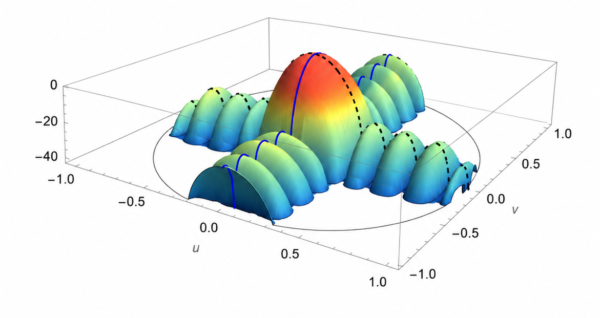
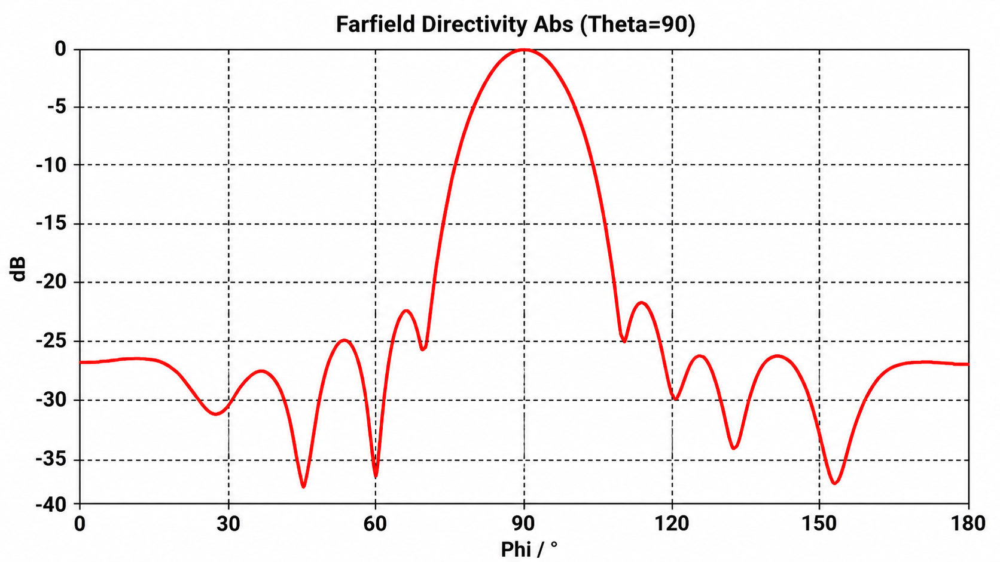
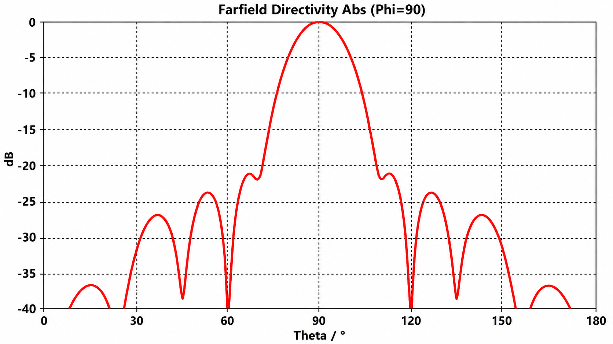
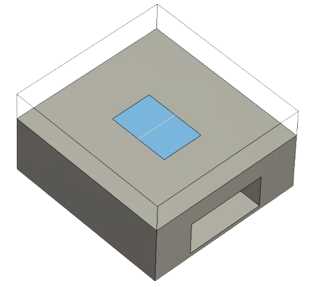
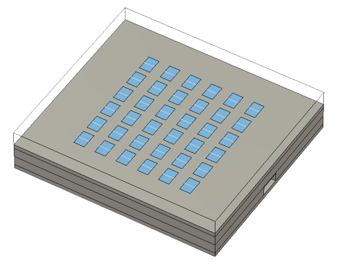
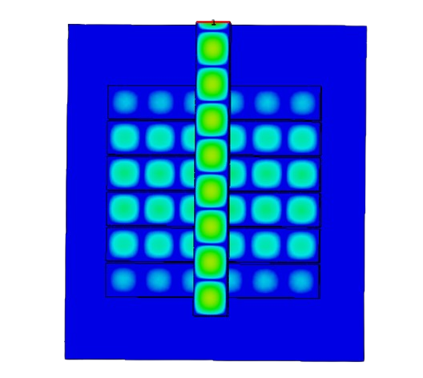
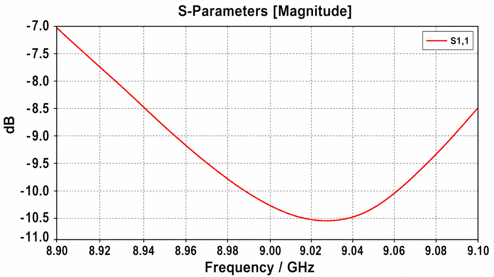
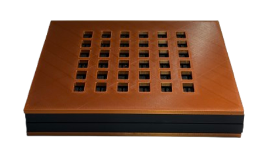
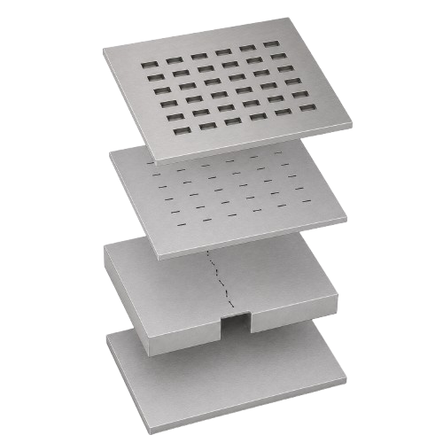

# EGH490 Research Project (High Distinction)

**Slot arrays radiating through truncated waveguides, to combat the formation of second-order lobes.**

Honours research project at the Queensland University of Technology (QUT), School of Electrical
Engineering and Robotics, Semester 1 2026.

**Student:** Chabod Masere &nbsp;·&nbsp; **Supervisor:** Dr Jacob Coetzee &nbsp;·&nbsp; **Report:** [Honours_Submission.pdf](Honours_Submission.pdf)

<p align="center">
  
</p>

## The problem

A slotted waveguide array radiates a main beam, but the regular slot layout also sends power
into unwanted second-order lobes off to the sides. Those lobes waste power and reduce how well
the antenna can discriminate between directions. This project tests whether letting each slot
radiate through a short truncated waveguide, with the slot geometry varied across the array,
can suppress them.

The design target was a sidelobe level of **−25 dB** at **9 GHz**.

## Result

A truncated 6 × 6 array with non-uniform slot geometry, simulated in CST:

| Metric | Result |
| --- | --- |
| Sidelobe level, constant-θ cut | −23.2 dB (1.8 dB short of the −25 dB target) |
| Sidelobe level, constant-φ cut | −21.8 dB |
| 3 dB beamwidth | 14.2° and 13.7° in the two cuts |
| Main beam direction | Broadside (φ = 90°) |
| Reflection coefficient S11 | About −10.5 dB near 9 GHz |

<p align="center">
  
  
</p>

The target was not met, but both cuts clear −20 dB, which supports the approach as a first-pass
optimisation method. The result is from simulation only: the printed prototype checks the
geometry, and measured validation needs a metal build (see [Prototype](#prototype)).

## Method

### 1. Single-slot sweep

A single cavity-backed slot in a WR-90 waveguide section (22.86 mm × 10.16 mm) was swept in CST over
cavity-slot offset (0.6 mm to 5.0 mm, 23 values) and cavity-slot length (15.0 mm to 17.0 mm, 21 values), giving
**483 simulation cases**. The S-parameters of each case were converted to the slot's normalised
self-admittance, `Gself` and `Bself`.

<p align="center">
  
  
</p>

For each offset, the resonant length is where the susceptance `Bself` crosses zero, and the
conductance there sets how strongly that slot radiates.

### 2. Array synthesis

The sweep acts as a lookup table. [`spline.m`](Multiarray_Extracts/spline.m) fits splines through
the resonant points, sets a tapered target conductance for each of the 36 slots (strongest in the
centre, weakest at the edges), and solves for the offset and length each slot needs. The offsets
alternate sign along each row.

### 3. Full-array simulation

The 36 slot geometries were built into a layered CST model: base plate, coupling slots,
cavity layer and radiating slot layer.

<p align="center">
  
  
</p>

[`vapp_analysis.cpp`](Multiarray_Extracts/vapp_analysis.cpp) takes the complex applied voltage at
each of the 36 slots and reports magnitude, phase, normalised magnitude and phase deviation, to
check that the aperture is tapered and in phase as intended. Build and run it with:

```bash
g++ -O2 -std=c++17 vapp_analysis.cpp -o vapp_analysis
./vapp_analysis
```

<p align="center">
  
</p>

## Prototype

A PLA prototype was 3D printed on a Bambu Lab X1C to verify the layered geometry, slot definition
and assembly fit. PLA is not conductive, so it cannot be used for electromagnetic testing.

<p align="center">
  
  
</p>

**Future work:** fabricate a conductive prototype (for example stainless steel), measure S11 with a
vector network analyser, and measure the far-field pattern to compare against the CST results.

## Repository layout

```text
Honours_Submission.pdf        final report (65 pages, including data appendices)
Compiled_Data/
├── simulation_2 (Accepted)/  the 23 × 21 sweep used for the design: raw CST exports and one chart per offset
├── simulation_3/             a finer 33-offset sweep, with its workbook
└── simulation_4/             a further sweep, with its workbook
Multiarray_Extracts/          6 × 6 array work: spline synthesis, applied-voltage analysis, CST field exports
Graphical_Images/             far-field patterns, S11, Smith charts, equivalent circuits
Waveguide_Images/             CST model views, layer drawings, field plots, prototype photos
```

In each `single_slot_data/` folder, `s11.txt` and `s21.txt` are the S-parameters per run, and the
`curve*real.txt` and `curve*imag.txt` files are the real and imaginary parts of the electric field
`Ex` along the two reference curves (slot side and cavity side) at 9 GHz.

`spline.m` reads `OPEN_SLOT_CAVITY (SIM2).xlsm`, which is not in the repository, so it will not run
as checked in. The script is also listed in the report appendix.

## Key references

- J. C. Coetzee, "Cavity-backed waveguide slot array for elimination of second-order lobes," manuscript for *IEEE Transactions on Antennas and Propagation*, 2025.
- G. A. Casula, G. Mazzarella, G. Montisci and G. Muntoni, "A review on improved design techniques for high performance planar waveguide slot arrays," *Electronics*.
- M. Khazai and M. Khalaj-Amirhosseini, "To reduce side lobe level of slotted array antennas using nonuniform waveguides," *International Journal of RF and Microwave Computer-Aided Engineering*, 2015.
- M. Boyarsky, M. F. Imani and D. R. Smith, "Grating lobe suppression in metasurface antenna arrays with a waveguide feed layer," arXiv:1905.09846, 2019.

The full bibliography is in the report.

## Tools

| Tool | Used for |
| --- | --- |
| CST Studio Suite | Full-wave simulation and parametric sweeps |
| MATLAB | Spline interpolation and array synthesis |
| C++ | Applied-voltage magnitude and phase analysis |
| Excel | Admittance extraction and sweep records |
| Fusion 360, Bambu Lab X1C | CAD and the PLA prototype |

## Author

**Chabod Masere**

🎓 Master of Robotics and Artificial Intelligence
<br>
🎓 Bachelor of Engineering, Electrical & Aerospace
